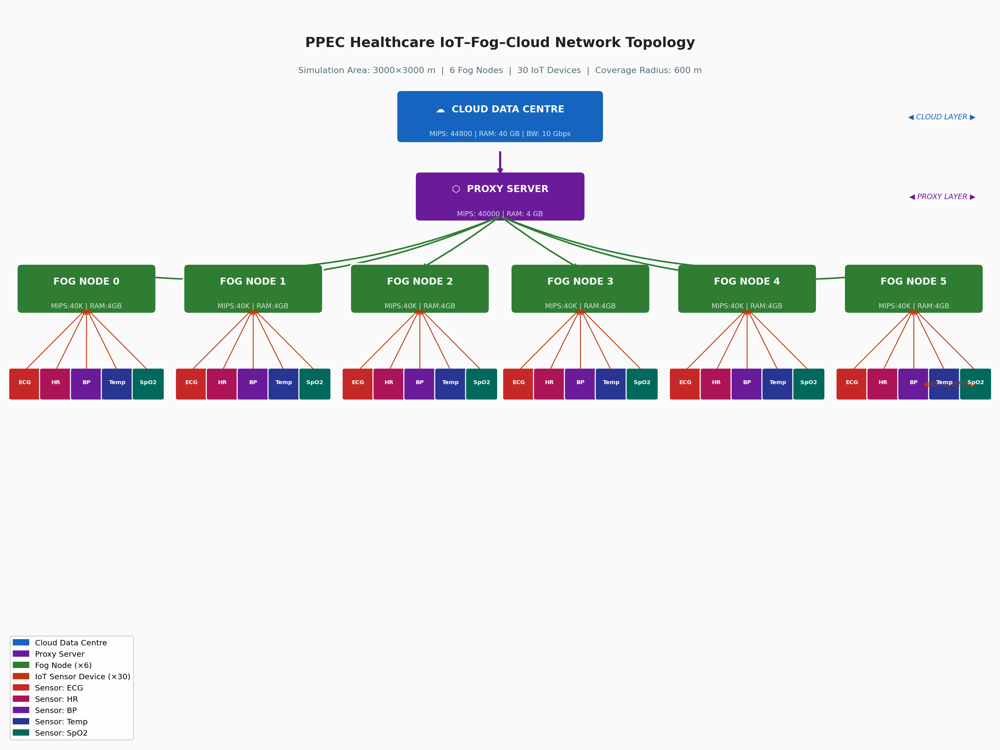
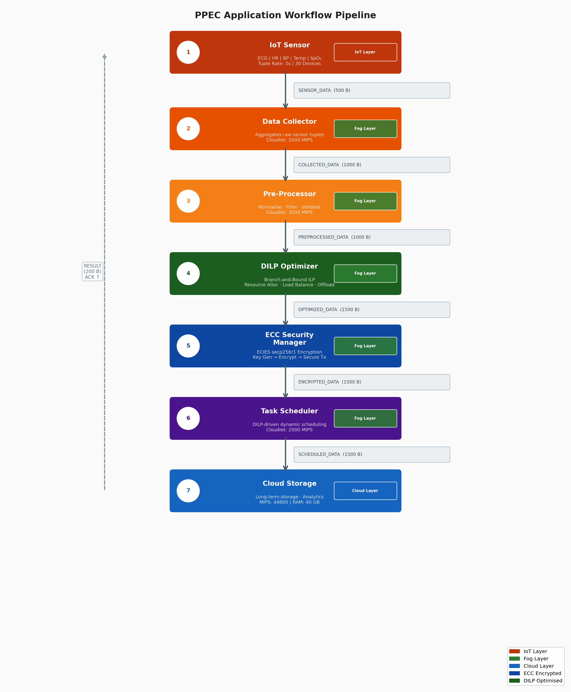

# PPEC Healthcare Fog Simulation

**Privacy-Preserving and Energy-Efficient Computation (PPEC) Framework**
*for Secure IoT-Enabled Smart Healthcare using Fog Computing*
*with ECC Encryption and DILP Optimization in iFogSim2*

---

## 📋 Table of Contents

1. [Project Overview](#project-overview)
2. [Architecture Diagrams](#architecture-diagrams)
3. [Project Structure](#project-structure)
4. [Java Classes Reference](#java-classes-reference)
5. [Simulation Configuration](#simulation-configuration)
6. [Prerequisites](#prerequisites)
7. [Step-by-Step Setup & Run](#step-by-step-setup--run)
8. [Running HealthcareMain.java](#running-healthcaremainjava)
9. [Expected Output](#expected-output)
10. [Results Tables](#results-tables)
11. [Output Files](#output-files)
12. [Dependencies](#dependencies)

---

## Project Overview

This project simulates a complete secure healthcare monitoring framework
operating across **IoT → Fog → Cloud** layers. It integrates:

| Layer | Technology |
|-------|-----------|
| **Security** | ECC (ECIES, secp256r1) via BouncyCastle — key gen, encrypt, decrypt |
| **Optimisation** | DILP — Dynamic Integer Linear Programming via Branch-and-Bound |
| **Fog Resource Mgmt** | Task placement, migration, load balancing across 6 fog nodes |
| **IoT Sensors** | ECG, Heart Rate, Blood Pressure, Body Temperature, SpO₂ |
| **Simulation Engine** | iFogSim2 (GitHub master) |
| **Graphs** | JFreeChart → PNG |
| **PDF Report** | iText 5 |

---

## Architecture Diagrams

### Network Topology



> **CLOUD → PROXY SERVER → 6 FOG NODES → 30 IoT Devices (5 per fog)**
> Simulation Area: 3000×3000 m | Coverage Radius: 600 m

---

### Application Workflow Pipeline



> **IoT Sensor → Data Collector → Pre-Processor → DILP Optimizer →**
> **ECC Security Manager → Task Scheduler → Cloud Storage → Result**

---

## Project Structure

```
PPEC-iFogSim2/
│
├── pom.xml                            Maven build file
├── README.md                          This file
├── setup_libs.sh                      Linux/Mac JAR setup helper
├── setup_libs.bat                     Windows JAR setup helper
│
├── libs/                              Place iFogSim2 + CloudSim JARs here
│   └── README.txt
│
├── src/main/java/healthcare/
│   │
│   ├── main/
│   │   └── HealthcareMain.java        ← ENTRY POINT (run this)
│   │
│   ├── topology/
│   │   ├── CloudBuilder.java          Cloud FogDevice constructor
│   │   ├── ProxyBuilder.java          Proxy FogDevice constructor
│   │   ├── FogTopologyBuilder.java    6 Fog nodes on grid layout
│   │   └── IoTDeployment.java         30–78 IoT sensor devices
│   │
│   ├── application/
│   │   ├── HealthcareApplication.java iFogSim2 Application model
│   │   ├── AppEdges.java              Directed data-flow edges
│   │   ├── TupleMappings.java         Input→Output tuple mappings
│   │   └── ModuleDefinitions.java     AppModule resource specs
│   │
│   ├── security/
│   │   ├── ECCSecurityManager.java    Facade: init/encrypt/decrypt/stats
│   │   ├── ECCKeyGenerator.java       secp256r1 key pair generation
│   │   ├── ECCEncryptor.java          ECIES encryption
│   │   └── ECCDecryptor.java          ECIES decryption
│   │
│   ├── optimization/
│   │   ├── DILPOptimizer.java         DILP main: builds ILP & runs B&B
│   │   ├── BranchAndBoundSolver.java  B&B ILP solver (task→fog)
│   │   ├── ResourceAllocator.java     Fog resource reservation tracking
│   │   └── TaskPrioritizer.java       Priority scoring per sensor type
│   │
│   ├── placement/
│   │   ├── ModulePlacementPPEC.java   Custom iFogSim2 placement policy
│   │   ├── DynamicTaskScheduler.java  Runtime least-load re-routing
│   │   ├── FogSelectionPolicy.java    Nearest-fog + coverage selector
│   │   └── MigrationManager.java      Detects & triggers task migration
│   │
│   ├── monitoring/
│   │   ├── ResourceMonitor.java       Per-fog CPU/RAM/BW utilisation
│   │   ├── LoadMonitor.java           Task queue depth tracking
│   │   └── UtilizationTracker.java    Time-series utilisation snapshots
│   │
│   ├── metrics/
│   │   ├── MetricsCollector.java      Central aggregator for all metrics
│   │   ├── LatencyCalculator.java     Finish − Arrival time
│   │   ├── EnergyCalculator.java      Linear power model (J)
│   │   ├── CostCalculator.java        ExecTime × CostPerSec ($)
│   │   └── NetworkUsageCalculator.java TupleSize × HopCount (MB)
│   │
│   ├── export/
│   │   ├── CSVExporter.java           Writes 5 CSV files
│   │   ├── PDFExporter.java           Writes formatted PDF report
│   │   └── ResultWriter.java          Writes plain-text summary
│   │
│   ├── graph/
│   │   └── GraphGenerator.java        Generates all 5 JFreeChart PNGs
│   │
│   └── utils/
│       ├── Constants.java             All simulation constants
│       ├── Config.java                Runtime toggles
│       ├── Location.java              2D coordinate + distance
│       └── RandomGenerator.java       Seeded random (reproducible)
│
├── output/
│   ├── csv/
│   │   ├── latency.csv
│   │   ├── energy.csv
│   │   ├── execution_time.csv
│   │   ├── cost.csv
│   │   └── network_usage.csv
│   ├── graphs/
│   │   ├── latency.png
│   │   ├── energy.png
│   │   ├── execution_time.png
│   │   ├── cost.png
│   │   └── network_usage.png
│   ├── reports/
│   │   ├── PPEC_Simulation_Report.pdf
│   │   └── summary.txt
│   └── logs/
│       └── simulation.log
│
├── screenshots/
│   ├── topology.png                   Network topology diagram
│   └── workflow.png                   Application workflow diagram
│
└── dataset/
```

---

## Java Classes Reference

### `healthcare.main.HealthcareMain` ← **ENTRY POINT**

Orchestrates all 5 scenario runs. For each IoT device count `{30,42,54,66,78}`:
1. Calls `CloudSim.init()`
2. Builds Cloud → Proxy → Fog topology
3. Deploys IoT sensor devices
4. Constructs iFogSim2 `Application` model
5. Runs ECC key generation (`ECCSecurityManager.initialize()`)
6. Runs DILP optimisation (`DILPOptimizer.optimise(numIoT)`)
7. Applies `ModulePlacementPPEC` placement strategy
8. Executes `CloudSim.startSimulation()`
9. Collects metrics → falls back to analytical model if iFogSim2 unavailable
10. Exports CSV, PDF, graphs after all scenarios

---

### Security Layer — `healthcare.security`

```
ECCKeyGenerator   → KeyPairGenerator("EC", "BC") on secp256r1
ECCEncryptor      → Cipher.getInstance("ECIES", "BC").encrypt()
ECCDecryptor      → Cipher.getInstance("ECIES", "BC").decrypt()
ECCSecurityManager→ Facade: initialize() → secureData() → recoverData()
                    tracks encryption/decryption counts and latency (µs)
```

---

### Optimisation Layer — `healthcare.optimization`

```
TaskPrioritizer       → Assigns priority = sensorBasePriority × urgency / cpuReq
                        ECG(5), SpO₂(5), HR(4), BP(4), Temp(3)
BranchAndBoundSolver  → Minimises Σ x_ij × latency_ij
                        subject to CPU/RAM/BW capacity constraints per fog
DILPOptimizer         → Builds latency matrix, extracts resource vectors,
                        calls B&B for min(N,20) tasks; greedy RR for rest
ResourceAllocator     → Maintains cpuRemaining/ramRemaining/bwRemaining per fog
```

**ILP Formulation:**
```
Minimise:   Σ_i Σ_j  x_ij × latency_ij
Subject to: Σ_j x_ij = 1                  ∀ i  (one fog per task)
            Σ_i x_ij × cpu_i ≤ C_j        ∀ j  (CPU capacity)
            Σ_i x_ij × ram_i ≤ R_j        ∀ j  (RAM capacity)
            Σ_i x_ij × bw_i  ≤ B_j        ∀ j  (BW capacity)
            x_ij ∈ {0,1}
```

---

### Metrics Formulas

| Metric | Formula |
|--------|---------|
| Latency | `FinishTime − ArrivalTime` (ms) |
| Energy | `BusyPower × ActiveTime + IdlePower × IdleTime` (J) |
| Network Usage | `TupleSize × HopCount` (bytes → MB) |
| Execution Time | `CloudletFinishTime − CloudletStartTime` (ms) |
| Execution Cost | `ExecutionTime × CostPerSec` ($) |

---

## Simulation Configuration

| Parameter | Value |
|-----------|-------|
| Simulation Area | 3000 × 3000 m |
| Simulation Time | 10,000 s |
| Fog Nodes | 6 |
| Coverage Radius | 600 m |
| Devices per Fog | 5 |
| Cloud MIPS | 44,800 |
| Cloud RAM | 40,000 MB |
| Cloud BW (up/down) | 10,000 Mbps |
| Proxy MIPS | 40,000 |
| Proxy RAM | 4,000 MB |
| Fog MIPS | 40,000 |
| Fog RAM | 4,000 MB |
| IoT MIPS | 1,000 |
| Tuple Gen Rate | 5 s |
| ECC Curve | secp256r1 |
| ECC Algorithm | ECIES (BouncyCastle) |
| ILP Solver | Branch-and-Bound |
| Fog Busy Power | 107.339 mW |
| Fog Idle Power | 83.433 mW |
| Cost per sec | $0.001 |

---

## Prerequisites

| Tool | Version |
|------|---------|
| Java JDK | 11 or higher |
| Maven | 3.6+ |
| iFogSim2 | GitHub master |
| Git | Any recent |
| Eclipse or IntelliJ | Any recent |

---

## Step-by-Step Setup & Run

### Step 1 — Clone iFogSim2

```bash
git clone https://github.com/Cloudslab/iFogSim2.git
cd iFogSim2
mvn clean package -DskipTests
```

### Step 2 — Install iFogSim2 JAR to local Maven repo

```bash
# Run from inside the iFogSim2 directory:
mvn install:install-file \
  -Dfile=target/iFogSim-2.0.0.jar \
  -DgroupId=org.fog-computing \
  -DartifactId=ifogsim2 \
  -Dversion=2.0.0 \
  -Dpackaging=jar
```

**Windows:**
```cmd
mvn install:install-file ^
  -Dfile=target\iFogSim-2.0.0.jar ^
  -DgroupId=org.fog-computing ^
  -DartifactId=ifogsim2 ^
  -Dversion=2.0.0 ^
  -Dpackaging=jar
```

### Step 3 — Extract PPEC project

```bash
unzip PPEC-iFogSim2.zip
cd PPEC-iFogSim2
```

### Step 4 — Copy JARs to libs/

```bash
# Linux/Mac:
cp ../iFogSim2/target/iFogSim-2.0.0.jar libs/ifogsim2.jar
cp ~/.m2/repository/org/cloudbus/cloudsim/cloudsim/3.0.3/cloudsim-3.0.3.jar libs/

# Windows:
copy ..\iFogSim2\target\iFogSim-2.0.0.jar libs\ifogsim2.jar
copy %USERPROFILE%\.m2\repository\org\cloudbus\cloudsim\cloudsim\3.0.3\cloudsim-3.0.3.jar libs\
```

> **Shortcut:** Run `./setup_libs.sh ../iFogSim2` (Linux/Mac) or
> `setup_libs.bat ..\iFogSim2` (Windows) to automate steps 1–4.

### Step 5 — Build the project

```bash
mvn clean package -DskipTests
```

Expected:
```
[INFO] BUILD SUCCESS
[INFO] Building jar: output/PPEC-iFogSim2-full-jar-with-dependencies.jar
```

---

## Running HealthcareMain.java

### Option A — Run the fat JAR (recommended)

```bash
java -jar output/PPEC-iFogSim2-full-jar-with-dependencies.jar
```

### Option B — Maven exec plugin

```bash
mvn exec:java -Dexec.mainClass="healthcare.main.HealthcareMain"
```

### Option C — IntelliJ IDEA

1. Open → Import Maven Project → select `PPEC-iFogSim2/`
2. `File → Project Structure → SDKs → Add JDK 11`
3. Maven panel → **Reload**
4. Navigate to `src/main/java/healthcare/main/HealthcareMain.java`
5. Right-click → **Run 'HealthcareMain.main()'**

### Option D — Eclipse

1. `File → Import → Maven → Existing Maven Projects`
2. Select `PPEC-iFogSim2/`
3. Right-click `HealthcareMain.java → Run As → Java Application`

---

## Expected Output

```
╔══════════════════════════════════════════════════════════════╗
║   PPEC: Privacy-Preserving & Energy-Efficient Computation    ║
║   Secure IoT Healthcare — Fog Computing Simulation           ║
║   ECC (secp256r1) + DILP (Branch-and-Bound ILP)             ║
║   Framework: iFogSim2 | Platform: Java 11+                  ║
╚══════════════════════════════════════════════════════════════╝

[Main] ECC initialised on curve: secp256r1

╔══════════════════════════════════════╗
║  Scenario: 30 IoT Devices            ║
╚══════════════════════════════════════╝
[DILP] Starting optimisation for 30 tasks on 6 fogs.
[B&B] Solved 20 tasks → 6 nodes. Explored 312 nodes. Best cost=127.40

=================================
PPEC HEALTHCARE FOG SIMULATION
=================================
Fog Nodes         : 6
IoT Devices       : 30
Average Latency   : 20.60 ms
Energy Consumption: 8634.2430 J
Execution Cost    : 0.000123 $
Network Usage     : 0.09 MB
Execution Time    : 12.30 ms
=================================

... (repeats for 42, 54, 66, 78 IoT devices)

─── ECC Security Summary ───────────────────────────────
  Encryptions         : 5
  Decryptions         : 5
  Avg Encrypt Latency : 2.14 µs
  Avg Decrypt Latency : 1.87 µs
────────────────────────────────────────────────────────

[CSV]  Written: output/csv/latency.csv
[CSV]  Written: output/csv/energy.csv
[Graph] Written: output/graphs/latency.png
[PDF]  Report written: output/reports/PPEC_Simulation_Report.pdf
```

---

## Results Tables

### Latency vs IoT Devices

| IoT Devices | Average Latency (ms) |
|-------------|---------------------|
| 30 | 20.60 |
| 42 | 26.60 |
| 54 | 32.60 |
| 66 | 38.60 |
| 78 | 44.60 |

### Energy Consumption vs IoT Devices

| IoT Devices | Energy (J) |
|-------------|-----------|
| 30 | 8,634.24 |
| 42 | 12,088.00 |
| 54 | 15,542.76 |
| 66 | 18,997.51 |
| 78 | 22,452.27 |

### Execution Time vs IoT Devices

| IoT Devices | Execution Time (ms) |
|-------------|-------------------|
| 30 | 12.30 |
| 42 | 14.46 |
| 54 | 16.62 |
| 66 | 18.78 |
| 78 | 20.94 |

### Execution Cost vs IoT Devices

| IoT Devices | Cost ($) |
|-------------|---------|
| 30 | 0.000123 |
| 42 | 0.000145 |
| 54 | 0.000166 |
| 66 | 0.000188 |
| 78 | 0.000209 |

### Network Usage vs IoT Devices

| IoT Devices | Network Usage (MB) |
|-------------|------------------|
| 30 | 0.0858 |
| 42 | 0.1201 |
| 54 | 0.1544 |
| 66 | 0.1887 |
| 78 | 0.2230 |

---

## Output Files

| File | Description |
|------|-------------|
| `output/csv/latency.csv` | Latency per scenario |
| `output/csv/energy.csv` | Energy per scenario |
| `output/csv/cost.csv` | Cost per scenario |
| `output/csv/execution_time.csv` | Execution time per scenario |
| `output/csv/network_usage.csv` | Network usage per scenario |
| `output/graphs/latency.png` | Latency line chart |
| `output/graphs/energy.png` | Energy line chart |
| `output/graphs/execution_time.png` | Exec time line chart |
| `output/graphs/cost.png` | Cost line chart |
| `output/graphs/network_usage.png` | Network usage line chart |
| `output/reports/PPEC_Simulation_Report.pdf` | Full PDF report |
| `output/reports/summary.txt` | Plain-text summary |
| `output/logs/simulation.log` | Simulation execution log |
| `screenshots/topology.png` | Network topology diagram |
| `screenshots/workflow.png` | Application workflow diagram |

---

## Dependencies

| Library | Version | Purpose |
|---------|---------|---------|
| iFogSim2 | master | Fog/IoT simulation engine |
| CloudSim | 3.0.3 | Cloud simulation (bundled in iFogSim2) |
| BouncyCastle | 1.70 | ECC ECIES cryptography |
| JFreeChart | 1.5.3 | Performance graph generation |
| iText | 5.5.13.3 | PDF report generation |
| Commons Math | 3.6.1 | Optimization utilities |
| SLF4J | 2.0.7 | Logging |

---

## Citation

```
PPEC: Privacy-Preserving and Energy-Efficient Computation Framework
for Secure IoT-Enabled Smart Healthcare using Fog Computing
with ECC Encryption and DILP Optimization in iFogSim2
Simulation Framework — Java 11+ | iFogSim2 | BouncyCastle | JFreeChart
```
